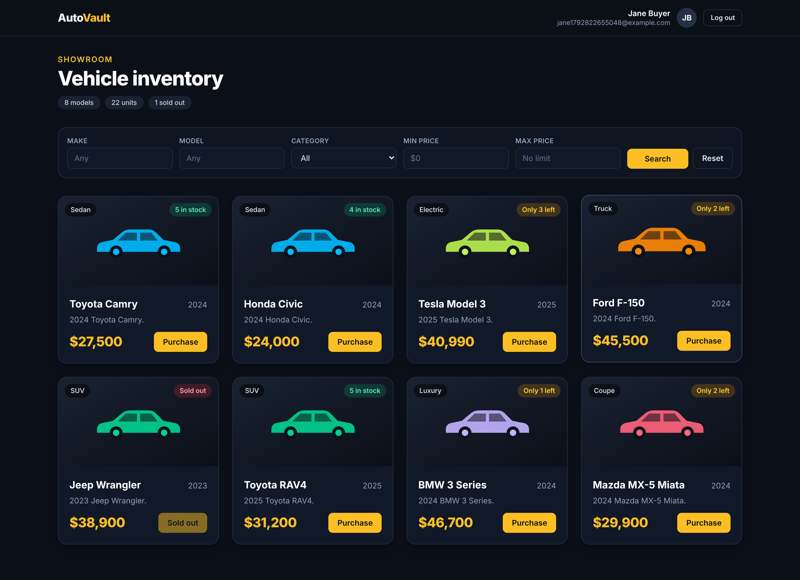
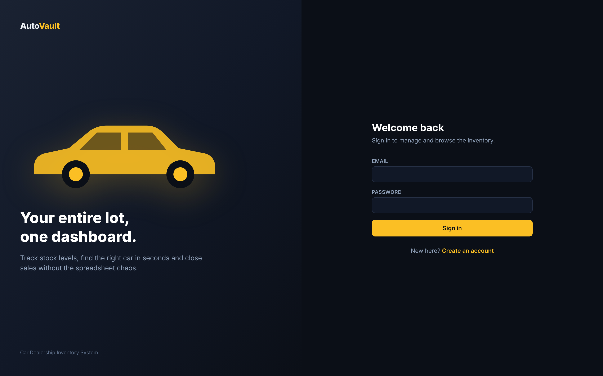
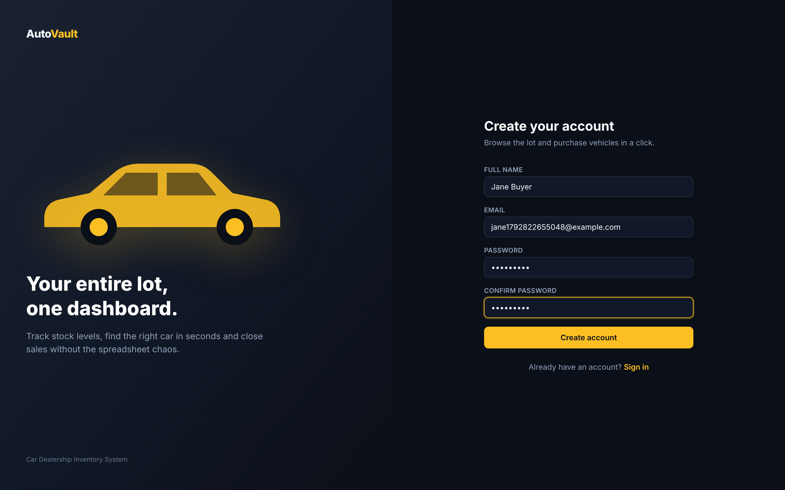
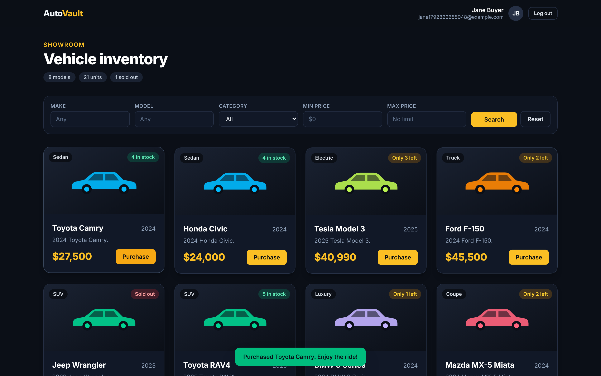
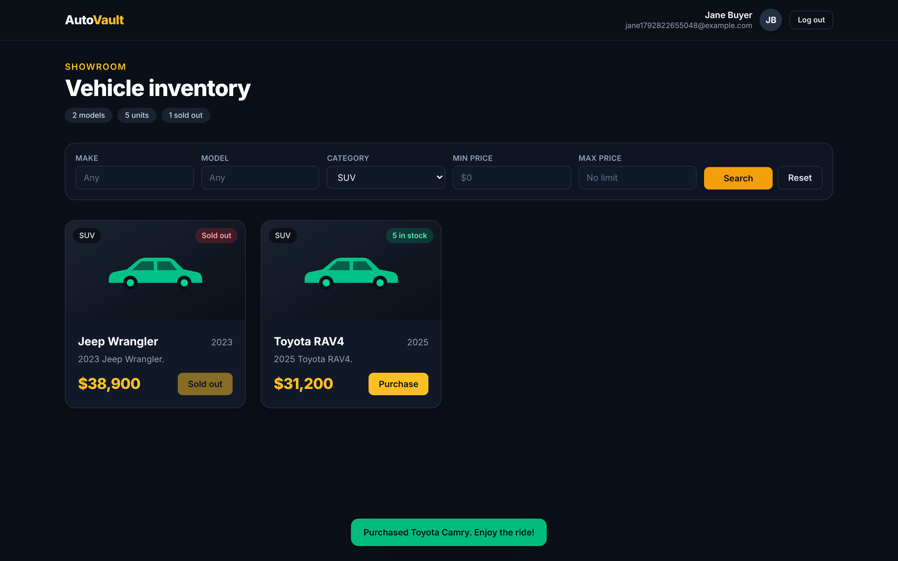
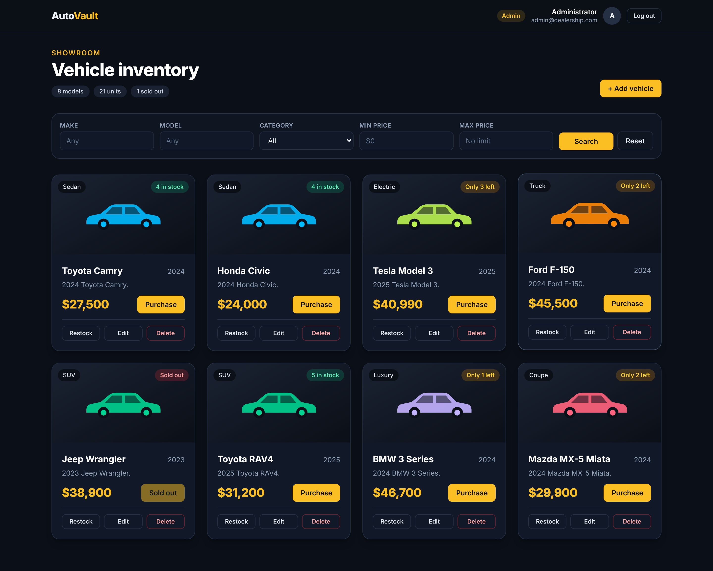
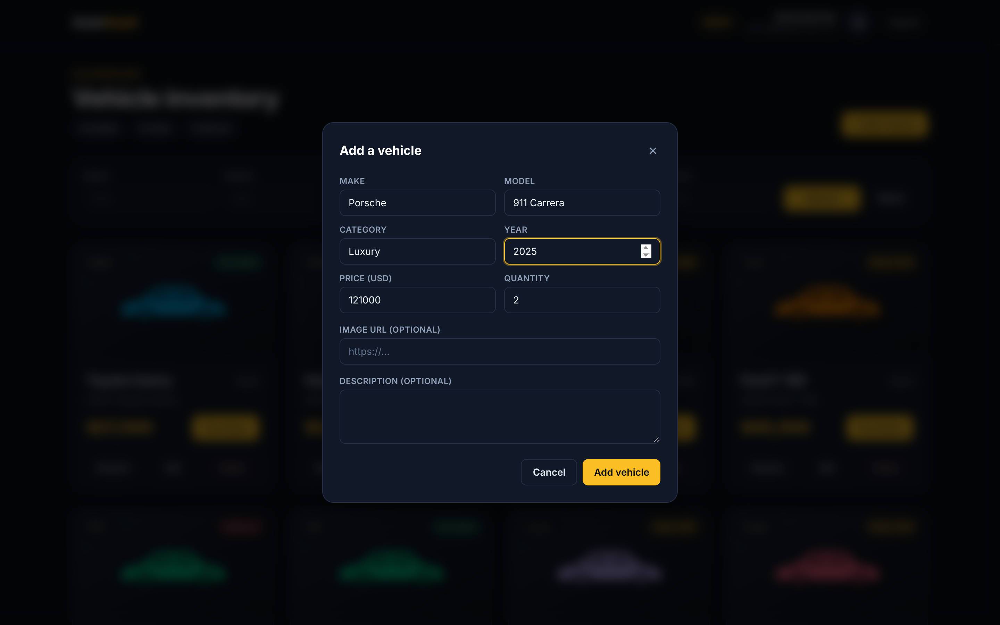
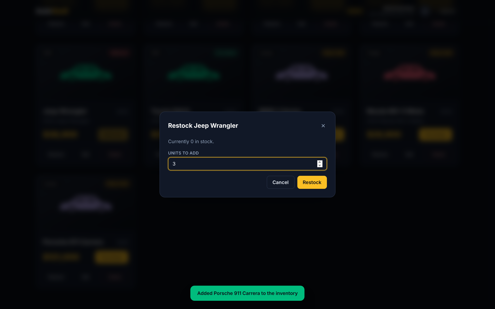
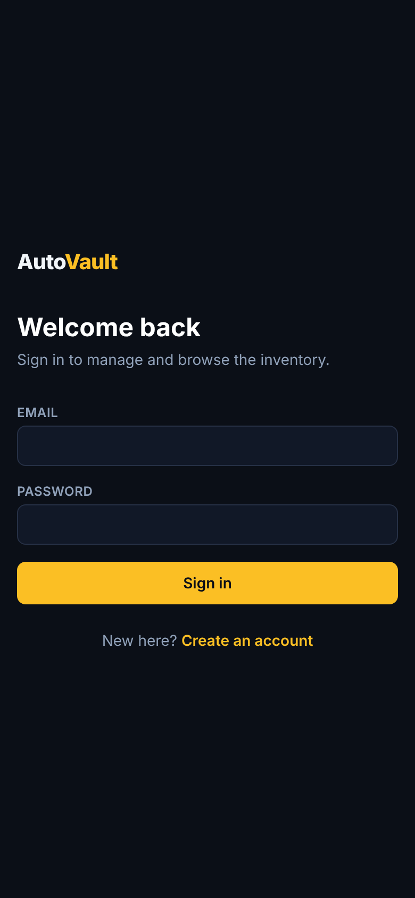

# AutoVault — Car Dealership Inventory System

A full-stack inventory system for a car dealership, built test-first (TDD). Shoppers browse and
buy vehicles; admins manage the catalogue and restock it.



- **Backend** — Node.js + TypeScript, Express 5, SQLite (better-sqlite3), JWT auth, Jest + Supertest
- **Frontend** — React 19 + TypeScript, Vite, Tailwind CSS v4, React Router, Vitest + Testing Library
- **Tests** — 126 tests (78 backend, 48 frontend), ~99% backend and ~98% frontend coverage

---

## Table of contents

1. [Features](#features)
2. [Quick start](#quick-start)
3. [API reference](#api-reference)
4. [How it works, end to end](#how-it-works-end-to-end)
5. [Project structure](#project-structure)
6. [Testing](#testing)
7. [Screenshots](#screenshots)
8. [Design decisions](#design-decisions)
9. [My AI Usage](#my-ai-usage)

---

## Features

**Everyone (after signing in)**

- Register and log in; the session persists across page reloads
- Browse every vehicle with stock badges (`5 in stock`, `Only 2 left`, `Sold out`)
- Search and filter by make, model, category and price range
- Purchase a vehicle; the button is disabled when stock is zero

**Admins only**

- Add, edit and delete vehicles
- Restock a vehicle to bring it back on sale
- Admin-only controls are hidden in the UI *and* enforced on the server

---

## Quick start

**Prerequisites:** Node.js 20 or newer (built on Node 22) and npm.

### 1. Backend

```bash
cd backend
npm install
cp .env.example .env        # edit JWT_SECRET for anything but local use
npm run seed                # optional: 8 demo vehicles
npm run dev                 # http://localhost:4000
```

The admin account is created on startup from `ADMIN_EMAIL` / `ADMIN_PASSWORD` in `.env`
(default `admin@dealership.com` / `Admin@123`). Anyone registering through the UI is always a
regular user — the role cannot be set from the request body.

### 2. Frontend

In a second terminal:

```bash
cd frontend
npm install
npm run dev                 # http://localhost:5173
```

Vite proxies `/api` to `http://localhost:4000`, so no CORS setup is needed in development.

### 3. Try it

| Role    | Email                    | Password    |
| ------- | ------------------------ | ----------- |
| Admin   | `admin@dealership.com`   | `Admin@123` |
| Shopper | register your own        | —           |

### Environment variables (`backend/.env`)

| Variable         | Default            | Purpose                                            |
| ---------------- | ------------------ | -------------------------------------------------- |
| `PORT`           | `4000`             | API port                                            |
| `DATABASE_PATH`  | `./dealership.db`  | SQLite file location                                |
| `JWT_SECRET`     | dev fallback       | Token signing key — **required** in production      |
| `JWT_EXPIRES_IN` | `1d`               | Token lifetime                                      |
| `ADMIN_EMAIL`    | —                  | Seeds an admin on startup (with `ADMIN_PASSWORD`)   |
| `ADMIN_PASSWORD` | —                  | Admin password for the seeded account               |
| `CORS_ORIGIN`    | all origins        | Restrict the browser origin in production           |

### Production build

```bash
cd backend  && npm run build && npm start   # compiles to dist/ and serves the API
cd frontend && npm run build                # static bundle in dist/
```

---

## API reference

All responses are JSON. Errors use `{ "error": "message" }`.

| Method   | Endpoint                     | Auth    | Description                               |
| -------- | ---------------------------- | ------- | ----------------------------------------- |
| `GET`    | `/api/health`                | public  | Liveness check                             |
| `POST`   | `/api/auth/register`         | public  | Create an account → `{ token, user }`      |
| `POST`   | `/api/auth/login`            | public  | Sign in → `{ token, user }`                |
| `GET`    | `/api/vehicles`              | user    | List every vehicle                         |
| `GET`    | `/api/vehicles/search`       | user    | Filter by `make`,`model`,`category`,`minPrice`,`maxPrice` |
| `GET`    | `/api/vehicles/:id`          | user    | One vehicle                                |
| `POST`   | `/api/vehicles`              | **admin** | Add a vehicle                            |
| `PUT`    | `/api/vehicles/:id`          | **admin** | Update any subset of fields              |
| `DELETE` | `/api/vehicles/:id`          | **admin** | Delete a vehicle                         |
| `POST`   | `/api/vehicles/:id/purchase` | user    | Decrease stock (default 1)                 |
| `POST`   | `/api/vehicles/:id/restock`  | **admin** | Increase stock                           |

Protected routes expect `Authorization: Bearer <jwt>`.

**Status codes:** `200` OK · `201` created · `204` deleted · `400` validation · `401` missing/invalid
token or bad credentials · `403` not an admin · `404` unknown vehicle · `409` duplicate email or
insufficient stock · `500` unexpected.

### Example

```bash
TOKEN=$(curl -s -X POST localhost:4000/api/auth/login \
  -H 'Content-Type: application/json' \
  -d '{"email":"admin@dealership.com","password":"Admin@123"}' | jq -r .token)

curl -s "localhost:4000/api/vehicles/search?category=SUV&maxPrice=40000" \
  -H "Authorization: Bearer $TOKEN"
```

---

## How it works, end to end

A detailed narrative walkthrough — request by request, file by file — is in
**[docs/WALKTHROUGH.md](docs/WALKTHROUGH.md)**. The short version:

```
Browser (React SPA)
  │  fetch('/api/…')  + Authorization: Bearer <jwt>
  ▼
Vite dev proxy  ──►  Express app
                       │  express.json()      parse body
                       │  authenticate()      verify JWT → req.user
                       │  requireRole('admin') for writes
                       │  route handler       zod validation
                       ▼
                     Service layer   business rules (stock, conflicts)
                       ▼
                     Repository      parameterised SQL
                       ▼
                     SQLite (dealership.db)
                       │
                       ▼
                     errorHandler    AppError → { error, status }
```

Every layer has one job: **routes** speak HTTP, **services** hold the rules, **repositories** hold
the SQL. That separation is what makes the tests small and the code easy to change.

---

## Project structure

```
car-dealership/
├── backend/
│   └── src/
│       ├── app.ts                 # composition root: wires everything together
│       ├── server.ts              # startup: config, DB, admin seed, listen
│       ├── config.ts              # environment variables → typed Config
│       ├── errors.ts              # AppError subclasses carrying HTTP status
│       ├── db/database.ts         # SQLite connection + schema
│       ├── middleware/            # authenticate, requireRole, validation, errors
│       ├── repositories/          # all SQL lives here
│       ├── routes/                # HTTP layer only
│       ├── services/              # business rules
│       └── validation/schemas.ts  # zod schemas
├── frontend/
│   └── src/
│       ├── api/                   # fetch client + typed endpoints
│       ├── components/            # VehicleCard, SearchFilters, VehicleForm, Modal, Navbar
│       ├── context/AuthContext    # session state
│       ├── pages/                 # Login, Register, Dashboard
│       └── utils/format.ts        # price and stock formatting
└── docs/
    ├── WALKTHROUGH.md             # end-to-end explanation
    ├── TEST_REPORT.md             # full test output and coverage
    └── screenshots/
```

---

## Testing

```bash
cd backend  && npm test            # 78 tests
cd backend  && npm run test:coverage
cd frontend && npm test            # 48 tests
cd frontend && npm run test:coverage
```

Full output and coverage tables: **[docs/TEST_REPORT.md](docs/TEST_REPORT.md)**.

| Suite    | Tests | Statements | Branches |
| -------- | ----- | ---------- | -------- |
| Backend  | 78    | 99.6%      | 93.1%    |
| Frontend | 48    | 98.5%      | 92.3%    |

The commit history follows **Red → Green → Refactor**: each `test(...)` commit adds failing tests,
the following `feat(...)` commit makes them pass.

```
test(auth):      add failing tests for register and login endpoints
feat(auth):      implement register and login with bcrypt and JWT
test(vehicles):  add failing tests for vehicle CRUD and search
feat(vehicles):  implement vehicle CRUD and search endpoints
…
```

---

## Screenshots

| Login | Register |
| --- | --- |
|  |  |

| Purchase confirmation | Filtered search |
| --- | --- |
|  |  |

| Admin dashboard | Add vehicle |
| --- | --- |
|  |  |

| Restock | Mobile |
| --- | --- |
|  |  |

---

## Design decisions

**Layered architecture (SOLID).** Routes, services and repositories each have a single
responsibility. Services depend on repository *interfaces* passed through the constructor, so tests
inject an in-memory database without touching production code.

**Stock changes are atomic.** A purchase is one conditional SQL statement:

```sql
UPDATE vehicles SET quantity = quantity - ? WHERE id = ? AND quantity >= ?
```

Reading the quantity and then writing it back would let two simultaneous buyers oversell the last
car. The check lives in the `WHERE` clause, so the database decides. There is a test that fires six
concurrent purchases at three units in stock and asserts exactly three succeed.

**Roles cannot be self-assigned.** `POST /api/auth/register` ignores any `role` in the body and
always creates a regular user; admins are seeded from environment variables.

**Identical login errors.** A wrong password and an unknown email both return
`Invalid email or password`, so the endpoint cannot be used to discover registered emails.

**Escaped LIKE patterns.** Search input is parameterised *and* has `%`/`_` escaped, so a user
searching for `%` gets no results instead of everything.

**SQLite over Postgres.** A real file-backed database (the brief rules out in-memory), with zero
setup for a reviewer. The repository layer is the only place that knows SQL, so swapping engines
means changing two files.

---

## My AI Usage

I used **Claude (Claude Code)** throughout this kata, as an interactive pair rather than a code
generator I copy from. My raw prompts are in [PROMPTS.md](PROMPTS.md).

### Which tools

- **Claude Code (Claude Opus)** — the main tool: scaffolding, writing tests and implementations,
  running the suite, driving the app in a headless browser.

### How I used it

**Writing tests first.** Each cycle began by asking for the *test file only* for a slice of
behaviour — auth, then vehicle CRUD, then inventory. I reviewed the list of cases before any
implementation existed, which is where I added the ones that mattered most: concurrent purchases,
SQL wildcards treated literally, and registration not being able to grant itself the admin role.

**Implementation after red.** Only once the tests failed for the right reason did I have the
implementation written. Keeping that order honest is what the commit history shows.

**Catching real bugs.** Two bugs were found by *running* things, not by reading code:

1. The Tailwind v4 `@apply btn` failure — invisible in unit tests because they don't load CSS. It
   surfaced the moment the app was driven in a real browser, and the fix (declaring `btn` as a
   `@utility`) is its own commit.
2. An ambiguous selector in the screenshot script (`Make` matched both the filter and the form),
   which was a reminder that accessible queries need scoping.

**Where I pushed back.** The first pass at purchase logic read the quantity and then wrote it
back. I rejected it and asked for a single conditional `UPDATE`, then added the concurrency test to
prove it. I also tightened validation (fractional quantities, negative prices) and insisted error
messages not leak which emails are registered.

### Reflection

AI made the mechanical parts fast — scaffolding, boilerplate, remembering Tailwind v4's syntax
changes — which left me more time on the parts that matter: deciding what to test, where the race
conditions are, and how the layers should be split. The risk is accepting plausible-looking code,
and TDD is a good defence: a test written before the implementation is a specification the AI has
to satisfy, not something it can talk its way around. The two bugs above are the clearest lesson —
passing unit tests are not the same as a working application, so I made running the real app part
of the loop.
